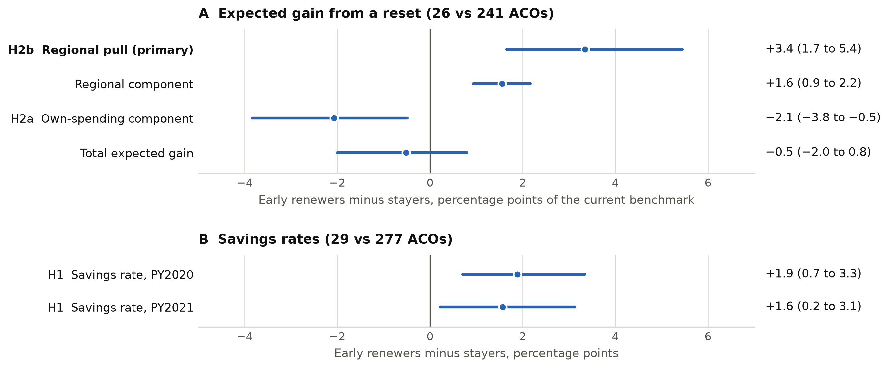
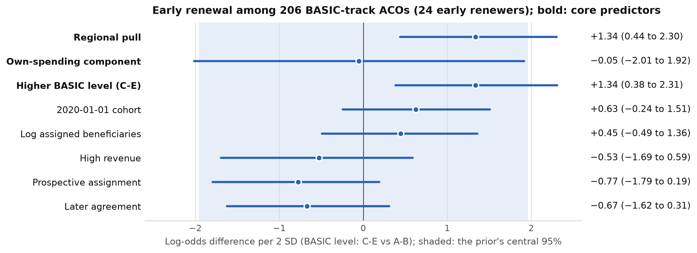

::: {.author-block}
Independent researcher\
ORCID: [0009-0008-4596-6921](https://orcid.org/0009-0008-4596-6921)\
Correspondence: Samuel Thomas Harrold, [samuel.harrold@gmail.com](mailto:samuel.harrold@gmail.com)

**Preregistration:** OSF Registries, [doi:10.17605/OSF.IO/C53W9](https://doi.org/10.17605/OSF.IO/C53W9), registered October 26, 2026, before any outcome data were read.\
**Keywords:** accountable care organizations; Medicare Shared Savings Program; benchmarks; alternative payment models; preregistration; difference-in-differences; Bayesian analysis\
**License:** CC BY 4.0
:::

# Abstract

**Importance:** Medicare Shared Savings Program (MSSP) benchmarks are reset at each new agreement from an
accountable care organization's (ACO's) recent spending, adjusted toward its region. ACOs could end an agreement
early to reset sooner; which ACOs did so has not been studied in the peer-reviewed literature.

**Objective:** To test whether ACOs that renewed early stood to gain more from the regional part of a reset, and
whether their spending growth differed afterward.

**Design, Setting, and Participants:** Preregistered retrospective cohort study of the 334 MSSP ACOs whose agreements
began July 1, 2019 or January 1, 2020, using CMS public use files (2016-2024). Plan, decision rules and code were
registered on OSF before any outcome data were read. The reset benchmark was rebuilt from 42 CFR 425.601 and
validated against CMS's published benchmarks for 101 other ACOs before use.

**Exposures:** For the choice of early renewal into a January 1, 2022 agreement (29 ACOs vs 277 that stayed):
the regional pull (case-mix-adjusted regional spending relative to the current benchmark; primary), the own-spending
component of a reset and the BASIC risk level. For spending, early renewal itself.

**Main Outcomes and Measures:** Early renewal, by group comparisons (Bayesian bootstrap, permutation tests) and a
Bayesian logistic model with measurement error tested by direct simulation; per-capita spending growth in 2022-2024,
by difference-in-differences with a preregistered equivalence condition on pre-trends.

**Results:** The rebuilt benchmark tracked CMS's (Spearman $\rho$ = 0.94). Relative to their current benchmarks,
early renewers' regional spending was 3.4 percentage points higher than stayers' (95% credible interval [CrI], 1.7
to 5.4; *P* < .001), but they were also beating their benchmarks by more (own-spending component, −2.1 points; 95%
CrI, −3.8 to −0.5), and the total expected gain did not differ (−0.5 points; 95% CrI, −2.0 to 0.8). Post hoc, CMS's
published 2022 benchmarks for early renewers averaged 1.3% below their 2021 benchmarks. Among 206 BASIC-track ACOs,
early renewal was associated with a higher regional pull (log-odds difference per 2 SD, 1.34; 95% CrI, 0.44 to 2.30)
and a higher, two-sided BASIC level (1.34; 95% CrI, 0.38 to 2.31). Spending growth did not differ detectably
(−0.4%; 95% CrI, −4.0% to 2.5%); the equivalence condition did not hold, so this is not read as an effect.

**Conclusions and Relevance:** ACOs that renewed early more often had regions that spent more relative to their
benchmarks and were more often at higher BASIC levels, for which renewal opened a 75% sharing rate; the reset did
not on average raise their benchmarks. These are associations under the 2022 rules; benchmarks set from 2024 credit
prior savings.

# Introduction

In the Medicare Shared Savings Program (MSSP), an accountable care organization (ACO) shares in savings when the
spending of its assigned beneficiaries falls below a benchmark.[@cfr425] At the start of each agreement period the
benchmark is reset from the ACO's own spending in the 3 preceding years and adjusted part of the way toward the
spending of its region.[@cfr425601] Evaluations have found modest savings from the program, growing with tenure and
larger in physician-group ACOs.[@mcwilliams2016; @mcwilliams2018; @bond2025] Whether selection, of clinicians,
beneficiaries or whole ACOs, shapes those estimates has been examined with differing results: one analysis found no
evidence of favorable risk selection in the original program,[@mcwilliams2020] while another found that accounting
for the nonrandom exit of high-cost clinicians removed the estimated savings,[@markovitz2019exit] and risk-adjustment
rules may lead ACOs to drop high-risk beneficiaries.[@markovitz2019risk]

Benchmarks are central to that selection. Rebasing to an ACO's own recent spending weakens its incentive to save,
and under earlier weights it rewarded higher spending just before a new agreement.[@douven2015] ACOs' spending
varies widely relative to their regions even after risk adjustment, so moving benchmarks toward regional averages
shifts them unevenly.[@rose2016] After regional spending entered benchmarks in 2017, participation shifted toward
providers whose spending was low relative to their region,[@lyu2023] ACOs whose effective benchmarks fell became
more likely to leave,[@chen2025] and bonuses rose for ACOs across the efficiency spectrum.[@srivastava2026] Survival in
the program has been associated with earning bonuses, higher benchmarks and one-sided risk,[@bleser2019] and larger
ACOs, those with supporting organizations and better performers were more likely to switch to two-sided
risk.[@zhu2023] The 2019 Pathways to Success rules, which shortened the time ACOs could stay in one-sided risk, were
followed by more exits than entries,[@ying2023] by ACO leaders reassessing potential savings against
losses,[@ying2024] and by departures with projected costs to Medicare.[@moloci2021] In a related model, most ACO
Investment Model ACOs exited once downside risk was required.[@trombley2022]

The same rules allowed an ACO to end its agreement early and begin a new one, which resets the benchmark
early.[@cfr425] For an ACO in the BASIC track, renewal was also the only way into the ENHANCED track before its
agreement ended, because the 2018 rule bars moving from BASIC to ENHANCED within an agreement period;[@frpathways]
ENHANCED shares 75% of savings, against at most 50% in BASIC.[@cfr425] Of the 334 ACOs whose agreements began July 1,
2019 or January 1, 2020, 29 ended them early and began new agreements on January 1, 2022.[@dataacos] An industry
report found that ACOs rebasing early in 2022 had higher gross savings rates beforehand than ACOs that did not, and
that the earlier incumbents among them moved from BASIC to ENHANCED,[@milliman2024] and consulting analyses model the
choice for individual ACOs.[@milliman2025] Which ACOs used the option bears on how benchmark rules sort ACOs, but to
the author's knowledge it has not been studied in the peer-reviewed literature.

Two motives predict early renewal. Under a **reset motive**, an ACO renews because its new benchmark would be
higher. Under a **sharing-rate motive**, a BASIC-track ACO renews to reach ENHANCED. The savings rate cannot separate
them: an ACO beating its benchmark would lose on the own-spending part of a reset, yet may gain on the regional part
if its region spends more. This study therefore took as its primary test the **regional pull**, a measure of how
far an ACO's case-mix-adjusted regional spending sat above its current benchmark, which contains no term for the
ACO's own benchmark-year spending. It asked whether early renewers stood to gain more from the regional part of a
reset than ACOs that stayed, which characteristics were associated with early renewal, and whether early renewers'
spending growth differed afterward. The analysis plan, hypotheses, decision rules and code were registered before
any outcome value was read.[@registration] Associations with pre-decision characteristics bear on the motives but
cannot establish them, and no test here can separate the two motives.

# Methods

## Study design and preregistration

This is a preregistered retrospective cohort study of ACO-level public data, reported following the Strengthening
the Reporting of Observational Studies in Epidemiology (STROBE) guideline[@vonelm2007] (checklist in Supplement
1). The analysis plan and the code commit that implements it were registered on OSF Registries on October 26, 2026,
13:22 UTC, with the plan's SHA-256 hash recorded.[@registration; @code] Before registration only the enrollment
files, the CMS data dictionaries, the regulation text and the column names (not the values) of the outcome files
were used. The enrollment files include each ACO's track and BASIC level, so the H3 prediction for the BASIC level
was made with those data available: it is preregistered but not blind to them. No savings rate, spending value,
benchmark or constructed variable was seen. The registry's own timestamp, rather than the repository's commit dates,
establishes that order. The code
also enforced it: every data file is hashed before it is read, and any file whose hash matches a performance-year
results file, a county spending file or the county assignment file could not be opened until the registration record
existed. The pipeline was written and tested on synthetic data with planted effects before registration. Analyses ran
in stages that each refused to start until the outputs they depend on existed: the power analysis was committed before
any confirmatory estimate, the robustness results (which depend only on validation and power) were committed before
the confirmatory results and read only together with them, and every results file was committed before its
estimates were read.

## Data sources

Four CMS public use files were used, all aggregate at the ACO or county level:[@dataacos; @dataresults; @datacounty;
@dataassigned] MSSP ACO enrollment files for PY2016-PY2024, performance-year (PY) financial and quality results for
PY2016-PY2024 (PY2023 and PY2024 only for the spending analysis), county-level expenditure and risk-score data on
assignable beneficiaries for 2019-2021, and counts of ACO-assigned beneficiaries by county for 2021. The 40 files
downloaded on October 22, 2026, each recorded with its size, SHA-256 hash and URL, also include files kept from the
design stage that no analysis reads; an archived copy of the snapshot is on OSF.[@osfproject] Cells with counts of 1
to 10 are suppressed in these files.[@suppression]

## Population and groups

The base population was the 334 ACOs whose PY2021 enrollment record showed an agreement start of July 1, 2019 (189
ACOs) or January 1, 2020 (145 ACOs). Both cohorts' agreements end December 31, 2024, so an ACO from either cohort with
a January 1, 2022 agreement in the PY2022 enrollment file had renewed early.[@cfr425] **Early renewers** (29 ACOs)
were compared with **stayers** (277 ACOs), those in the same agreement in PY2022; 42 stayers later renewed early into
2023 or 2024 agreements, so the comparison concerns the 2022 decision. The 28 ACOs absent from the PY2022 file (left
after PY2021) were described but entered no registered test (Figure 1). Of the 356 ACOs from these cohorts in the
PY2020 enrollment file, 22 were absent from the PY2021 file, and none had renewed into a 2021 agreement.

## Variables

**Expected gain from a reset.** CMS does not publish what an early renewer's benchmark would have been had it not
renewed, nor a stayer's had it reset. Following 42 CFR 425.601 as in force on January 1, 2022,[@cfr425601] the
registered plan rebuilt it in 6 steps for each of the 4 enrollment types (end-stage renal disease [ESRD], disabled,
aged/dual eligible, aged/non-dual eligible): (1) the equally weighted mean of the ACO's per-capita spending in
PY2019-PY2021, restated to PY2021 case mix and trended to 2021 dollars with the national-regional growth blend; (2)
risk-standardized county spending averaged with weights equal to the ACO's assigned person-years by county in 2021
(the published proxy for the benchmark year's assignment) and adjusted to the ACO's case mix;[@specv10] (3) the
regional adjustment, $w \times (\text{regional} - \text{rebased})$, with the phase-in weight $w$ and the cap of
425.601; (4) the approximate new benchmark, combining types by the ACO's PY2021 person-year shares; and (5) the
expected gain, $100 \times$ (new $-$ current) / current, where the current benchmark is the PY2021 updated per-capita
benchmark. The gain splits into an **own-spending component** (rebased spending relative to the current benchmark,
which is close to a restatement of the savings rate) and a **regional component** (the adjustment). Writing the
adjustment out shows that, before capping,

$$\text{regional component} = w \times (\text{pull} - \text{own}),$$

so the regional component is also tied to past savings. Step (6) is the primary measure, the **regional pull**,

$$\text{regional pull} = 100 \times \frac{\sum_e s_e R_e - B}{B},$$

where $R_e$ is the case-mix-adjusted regional spending for enrollment type $e$, $s_e$ the ACO's share of
person-years of that type, and $B$ its current per-capita benchmark. All 4 are in percentage points of the current
benchmark. They use final PY2021 data, published after the 2022 renewal decision was made during 2021, so they are
ex post measures of what ACOs could anticipate from CMS's quarterly reports and their own earlier results.

**Validation before use.** Several steps can only be approximated from public files. The plan therefore required the
rebuilt benchmark to be validated against the 2022 benchmarks CMS published for regular renewers (ACOs whose
scheduled agreements ended in 2021) before any expected-gain variable was estimated, with a pass rule of a Spearman
correlation of at least 0.80 and a median absolute percentage error of at most 5%, and a calibration step if the
slope of actual on rebuilt fell outside 0.9 to 1.1. Early renewers were excluded from the validation sample and the
2022 results file was filtered as it was loaded, so validation could not reveal their actual reset. A second check
compared the own-spending part with CMS's own benchmark-year spending for the same ACOs; its error SD set the
measurement-error SD used in the decision model.

**Other variables.** From the results files: the savings rate (CMS-reported savings as a share of the benchmark) in
PY2020 and PY2021, assigned beneficiaries, and log per-capita spending, PY2020-PY2024. From the enrollment files:
cohort, PY2021 track and BASIC level, revenue category, assignment method and agreement number. An ACO's PY2021
BASIC level reflects both the glide path's schedule and its own earlier choices: ACOs choose their entry level, can advance faster, and could pause the advance for 2021; ACOs experienced with performance-based risk could enter
only Level E or ENHANCED.[@cfr425600]

**Suppressed values.** Hidden cells needed for the expected gain were filled by registered rules in order: exact
recovery of a single hidden count from totals, the mean over years in which a value was shown, a regional ratio for
a type hidden in every year, and, for a hidden risk score, no restatement and the region's mean risk score. ACOs
still missing a variable were excluded from that analysis and counted; the plan required reporting as a limitation
any exclusion above 10% of either group.

## Hypotheses

The registered hypotheses were: **H2b (primary)**, early renewers had a larger regional pull than stayers; **H2a
(secondary)**, a larger own-spending component (close to H1 restated, so not counted as separate evidence); **H1
(descriptive)**, a difference in PY2020 savings rate, with no motive attributed to its sign; **H3**, among BASIC-track
ACOs, the probability of renewing early rises with the regional pull, the own-spending component and a higher BASIC
level; and **H4**, early renewal changed per-capita spending in PY2022-PY2024 (2-sided). H1 to H3 describe who chose
to reset and are associations. H4 concerns a bundled package (a new benchmark, for almost all a move to ENHANCED, and
new benchmark years) whose parts cannot be separated.

## Statistical analysis

**Group comparisons (H1, H2a, H2b).** The estimate was the difference in means, early renewers minus stayers, within
each cohort, averaged with weights proportional to the early renewers in each cohort. Its posterior was a Bayesian
bootstrap[@rubin1981] (10,000 draws of Dirichlet(1, ..., 1) weights within each cohort-by-group cell), reported as
the posterior mean, 95% equal-tailed credible interval (CrI) and posterior probability of a positive value. Significance
was by stratified permutation: labels were shuffled within cohort 10,000 times, and the 2-sided *P* value was
$(1 + \#\{|\hat\theta_\text{perm}| \ge |\hat\theta_\text{obs}|\}) / (1 + 10{,}000)$.[@phipson2010] When the *P* value
and the CrI disagree, both are reported and the disagreement noted.

**Decision model (H3).** A Bayesian logistic regression of early renewal among PY2021 BASIC-track ACOs on the 3 core
predictors and 5 adjustment factors (cohort, log assigned beneficiaries, high revenue, prospective assignment, later
agreement) was fit in PyMC[@pymc2023] with the No-U-Turn sampler[@hoffman2014] (4 chains of 2,000 tuning and 2,000
retained draws, target acceptance 0.95). Continuous predictors were centered and divided by 2 SD[@gelman2008] and binary
predictors centered, so each coefficient is a log-odds difference per 2 SD or per category; coefficients had Normal(0,
1) priors. The own-spending component entered as a latent true value observed with normal error, with the error SD
fixed by the validation step. Convergence required $\hat{R} \le 1.01$, bulk and tail effective sample sizes of at
least 400 and no divergences,[@vehtari2021] with one registered rerun; a Firth penalized regression[@firth1993;
@firthmodels] would have decided H3 had the model not converged. Because shuffling labels in a multi-predictor model
tests the joint null, each core predictor was tested by direct simulation under the reduced model: the model without
that predictor was fit, 10,000 outcome vectors were simulated from its posterior, the full model was refit to each,
and the observed coefficient was compared with that null distribution. A fit with Student-t(3, 0, 2.5) priors, after
Gelman and colleagues,[@gelmanprior2008] was the registered sensitivity analysis, with any differing core conclusion to
be flagged.

**Spending after renewal (H4).** For each ACO, $\Delta$ was the mean log per-capita spending over its included years
in PY2022-PY2024 minus the mean in PY2020-PY2021, and H4 applied the group-comparison estimator to $\Delta$, reported
as $100 \times (e^{\text{estimate}} - 1)$, the percent difference in spending growth. Log differences are also given in
log points (1 log point = 0.01 in log spending, about 1%). The comparison group was ACOs not yet renewed: a stayer's
years after it renewed into a 2023 or 2024 agreement were excluded, following the not-yet-treated design of Callaway
and Sant'Anna.[@callaway2021] With one pre-period change (PY2020 to PY2021, both affected by COVID-19) and about 29
treated ACOs, a nonsignificant pre-trend test is weak evidence of parallel trends,[@roth2022] so the plan replaced it
with an equivalence condition in the spirit of equivalence testing:[@lakens2017] H4 would be read as an effect only
if the larger absolute bound of the pre-trend CrI, scaled by the mean distance between period midpoints, was smaller
than the absolute H4 estimate. A trend-adjusted estimate (the pre-period slope carried forward, in the spirit of
Rambachan and Roth[@rambachan2023]) and risk-adjusted, balanced-panel, propensity-weighted[@rosenbaum1983] and
single-cohort estimates were reported beside it.

**Power.** Minimum detectable effects (MDEs) at 80% power and 2-sided $\alpha$ = .05 for 29 vs 277 ACOs were
computed after registration and committed before any confirmatory estimate: from the cross-ACO SD of the savings rate
in PY2016-PY2018 (H1), the SD of each constructed variable among stayers, computed after validation (H2a, H2b), and
the SD of the pre-period spending change (H4). For H3, detection was simulated at a log-odds difference of 0.5.

**Decision rules.** Fixed in the plan before any result. For H2b, *P* < .05 with a positive difference was to be
reported as "early renewers' regions spent more relative to their current benchmarks, evidence for the reset motive
beyond past savings," *P* < .05 with a negative difference as evidence against it, and otherwise as no detectable
difference. H2a used the same wording; H3 predictors were supported, contradicted or undetermined by their
direct-simulation *P* values; and H4 was reported as no detectable difference, grew less or grew more, read as an
effect only if the equivalence condition held. No test here could rule the sharing-rate motive in or out. As
registered, there is one primary test, and the 3 H3 tests and the H4 test are not adjusted for multiplicity.

**Covariate-adjusted estimates, conventional methods and robustness.** Reported beside the registered methods and not
used for decisions: covariate-adjusted estimates for H1, H2a and H2b from robust Bayesian linear regressions
(Student-t errors on the standardized variable, Normal(0, 1) priors) on early renewal and cohort, or cohort, track,
level and size; Welch *t* tests,[@welch1947] ordinary least squares with HC2 errors[@mackinnon1985] and
maximum-likelihood logistic regression in statsmodels;[@statsmodels2010] 2-way fixed effects with an event study and
errors clustered by ACO for H4; and the registered robustness checks: differences in medians, the January 1, 2020
cohort alone, PY2021 savings rates, the Firth model, benchmark years 2-3 only, no measurement-error model, complete
cases and unadjusted county spending. Variables were built in dbt[@dbt] on DuckDB;[@duckdb2019] the environment was
locked with uv;[@uv] MCMC diagnostics used ArviZ;[@arviz2019] every refit had its own seed from a fixed NumPy seed
sequence.[@numpy2020]

**Deviations.** All 7 analysis stages ran with code identical to the registered commit. After the last stage the
lockfile took security updates to 2 packages (filelock and virtualenv); no result was produced with it, and it is
logged as the one deviation. One sentence of the plan's background is imprecise: it describes ENHANCED as sharing 75%
of savings and losses, whereas it shares 75% of savings and up to 75% of losses.

## Post hoc checks (not registered)

After all registered results had been read, and in response to critical review of the draft, two checks of the
expected gain were added (eTable 12 in Supplement 1). They reuse the registered pipeline's tables and estimator,
change no registered file, and decide nothing. First, the validation was repeated on the change scale, the rebuilt
against the actual change from the PY2021 benchmark, for the same 101 regular renewers. Second, early renewers'
realized reset, their 2022 historical benchmark as CMS published it relative to their PY2021 benchmark, was compared
with the rebuilt gain, and their PY2021-to-PY2022 change in updated benchmark was compared with stayers' with the
group-comparison estimator above.

## Ethics

The study used only publicly available, aggregate data on organizations and counties published by CMS. It involved
no individual-level data, no interaction with people and no identifiable private information, so it was not human
participants research, and ethics committee or institutional review board approval and informed consent were not
required.

# Results

## Validation and sample

The rebuilt benchmark passed validation (eTable 1 in Supplement 1). For 101 of the 111 eligible regular renewers, it
had a Spearman correlation of 0.94 with the benchmark CMS published and a median absolute percentage error of 1.6%;
the slope of actual on rebuilt was 0.944, inside the registered range, so no calibration was applied. The
own-spending part agreed with CMS's benchmark-year spending (Spearman 0.95; median error 1.4%), and its error SD set
the measurement-error SD at 4.38 percentage points. That SD exceeds the own-spending component's spread among stayers
(SD 3.3). Under a classical error model it could not, so the validation errors are probably heavy-tailed (a normal
error with that SD would have a median absolute value near 3, against the 1.4% observed) or do not transfer exactly
to the study sample; a scale estimate from the median error (1.4826 × 1.4 ≈ 2.1) would be below the stayers' SD.
By the registered error model, the component is mostly noise at the level of one ACO; the savings
rates, which CMS reports directly, are the firmer evidence of how far ACOs were beating their benchmarks.

Early renewers were more often in the January 1, 2020 cohort and at BASIC's two-sided levels C to E in PY2021 than
stayers (Table 1); 16 of the 27 BASIC-track early renewers were at the highest level, E. Of those 27, 26 moved to
ENHANCED in their new agreements; stayers could not, because the rules bar that move within an agreement period. The expected-gain variables could not be built for
3 early renewers (10.3%) and 36 stayers (13.0%), both above the plan's 10% line. A diagnostic query run after the
results, outside the registered pipeline, found that in every one of these 39 ACOs CMS had suppressed the count of
assigned ESRD beneficiaries in every county of the 2021 assignment file, so the ESRD part of regional spending had no
county weights (for 15, the aged/dual counts were hidden too). The plan's fill rules cover hidden cells in the results
files, not fully hidden county weights, so these ACOs were excluded and counted, as registered. The same query showed
them to be smaller ACOs (median 6,702 and 8,578 assigned beneficiaries for excluded early renewers and stayers,
against 10,757 and 15,649 for those included). One early renewer and 3 stayers had hidden values filled by the
registered rules.

{{include tables/table1.md}}

{width=100%}

## Who renewed early

Relative to their current benchmarks, early renewers' case-mix-adjusted regional spending was 3.4 percentage points
higher than stayers' (95% CrI, 1.7 to 5.4; *P* < .001), above the MDE of 2.5 computed for 29 vs 277 ACOs, which is
slightly understated for the 26 vs 241 compared (Table 2 and Figure 2). By the registered rule, H2b was supported:
early renewers' regions spent more relative to their current benchmarks, evidence for the reset motive beyond past savings. The decomposition qualifies that reading. Weighted by the phase-in
weight, the pull difference was 1.6 points (eTable 9), and the regional component differed by the same 1.6 points
partly because a lower own-spending component also raises it; the total expected gain did not differ. The pull
difference therefore indicates that early renewers were low-cost relative to their regions more than that they stood
to gain a higher benchmark. At the median PY2021 benchmark of the study's ACOs, \$11,312 per beneficiary per year, the difference of 3.35
points is about \$379 per beneficiary-year of regional spending relative to the benchmark; the difference in the
regional component itself, what a reset would add, was 1.6 points, about \$176.

The own-spending component pointed the other way (−2.1 points; 95% CrI, −3.8 to −0.5; *P* = .003): early renewers'
recent spending was lower relative to their benchmarks, contrary to the reset motive by the rule's wording. Early
renewers also had higher savings rates in PY2020 (1.9 points; 95% CrI, 0.7 to 3.3) and PY2021 (1.6 points; 95% CrI,
0.2 to 3.1). The two parts of the gain offset: the regional component was larger for early renewers (1.6 points;
95% CrI, 0.9 to 2.2), the own-spending component smaller, and the total expected gain did not differ (−0.5 points;
95% CrI, −2.0 to 0.8; *P* = .33). In unweighted means the own-spending and regional parts summed to −5.3 + 3.7 = −1.6
points for early renewers and −3.2 + 2.2 = −1.0 for stayers: by the approximation, a reset would on average have
lowered both groups' benchmarks. Post hoc, CMS's published 2022 benchmarks bear this out for early renewers: their
reset historical benchmarks averaged 1.3% below their PY2021 benchmarks (median −1.5%; 66% of the 29 were lower), the
rebuilt gain had predicted −1.6 points on average against −1.4 realized for the 26 with both values, and their
updated benchmarks rose from PY2021 to PY2022 no more than stayers' (difference 0.0 points; 95% CrI, −2.0 to 2.2)
(eTable 12 in Supplement 1).

{{include tables/table2.md}}

{width=100%}

## Decision model

Among 206 BASIC-track ACOs (24 early renewers), early renewal was associated with a higher regional pull (log-odds
difference per 2 SD, 1.34; 95% CrI, 0.44 to 2.30; direct-simulation *P* = .002) and a higher BASIC level (log-odds
difference for levels C-E vs A-B, 1.34; 95% CrI, 0.38 to 2.31; *P* = .003); both predictions were supported (Table 3
and Figure 3). A log-odds difference of 1.34 multiplies the odds of renewing early by about 3.8. The own-spending
component was undetermined (−0.05; 95% CrI, −2.01 to 1.92; *P* = .19); its interval is the prior's 95% range,
because its measurement error exceeds its spread and the model could learn almost nothing about it. Without the
measurement-error layer it was −0.64 (95% CrI, −1.51 to 0.23). The model converged on its first fit (largest
$\hat{R}$ 1.001, no divergences), and the observed 24 early renewers fell inside the posterior predictive 95% range
of 14 to 37 (eTable 5 in Supplement 1). Under the Student-t prior, which converged on its registered rerun, the pull
(1.65; 95% CrI, 0.53 to 2.87) and BASIC-level (1.63; 95% CrI, 0.53 to 2.85) intervals also excluded zero, so no core
conclusion differs between priors. The power analysis gave detection rates of only 17% (pull) and 14% (BASIC level)
at a log-odds difference of 0.5, so estimates that pass the test are likely to overstate the true
effects;[@gelmancarlin2014] the directions are the result, and coefficients near 1.3 are probably too large.

{{include tables/table3.md}}

{width=100%}

## Spending after renewal

Spending growth from PY2020-PY2021 to PY2022-PY2024 did not differ detectably between 29 early renewers and 276
comparison ACOs not yet renewed (−0.4%; 95% CrI, −4.0% to 2.5%; *P* = .78; MDE 3.8 log points) (Table 4 and Figure
4). The pre-trend estimate was 0.7% (95% CrI, −2.3% to 4.9%; *P* = .58), not evidence against parallel trends, but
the equivalence condition did not hold: the scaled pre-trend bound, 2.41 years times 4.8 log points, was 11.5 log
points (about 12%), far above the absolute H4 estimate of 0.4 log points. The condition could have held only for an
estimate above about 12% in absolute value, 3 times the MDE, so with one pre-period it could not support reading an
estimate of plausible size as an effect, and a trend difference of the size the pre-period allows could hide an
effect in either direction. H4 is therefore reported as a difference in spending changes that cannot be told apart
from a continuation of a pre-period difference in trends. Under parallel trends, the interval rules out a drop in
spending growth of more than about 4% or a rise of more than about 2.5%; the trend-adjusted interval (−12.0% to
2.7%) is too wide to inform.

Attrition was uneven: by PY2024, 115 of 277 stayers (42%) had left the spending panel (72 left the program, 42 renewed
and 1 had no spending value), against 4 of 29 early renewers (14%) (eTable 8 in Supplement 1). The balanced panel of
ACOs with all 5 years gave −1.6% (95% CrI, −5.6% to 1.6%; *P* = .30).

{{include tables/table4.md}}

{width=100%}

## Robustness and conventional methods

Every registered verdict agreed with its conventional counterpart (eTable 7 in Supplement 1). For H2b, ordinary
least squares with HC2 errors gave 3.3 points (95% CI, 1.3 to 5.4; *P* = .001), and for H3 the maximum-likelihood
odds ratios were 4.0 (95% CI, 1.2 to 13.4) for the regional pull and 4.8 (95% CI, 1.5 to 15.6) for the BASIC level;
2-way fixed effects gave −1.5% (95% CI, −5.4% to 2.4%) for H4. H2b kept its direction in every robustness check
(eTable 3 in Supplement 1), but its size depended on the estimator: the difference in medians was 2.8 points, and the
robust (Student-t) regressions gave 2.1 (95% CrI, 0.5 to 3.8) with cohort and 2.2 (95% CrI, 0.7 to 3.8) with track,
level and size added, below the MDE of 2.5, so a few large values among early renewers carry part of the difference
in means; without the case-mix adjustment of regional spending the difference was 6.9. H2a and H1 kept their
direction but were weaker by medians (H2a, *P* = .09; H1, *P* = .06) and in the adjusted regressions, whose intervals
reached zero (H2a, −2.6 to 0.02; H1, −0.1 to 2.6). In H3 the BASIC-level interval stayed above zero in every check,
while the pull interval reached zero with the 2020 cohort alone (1.15; 95% CrI, −0.02 to 2.39) and with unadjusted
county spending (0.75; 95% CrI, −0.02 to 1.56) (eTable 4 in Supplement 1).

Among the exploratory analyses (eTables 9-11 in Supplement 1), the 28 ACOs that left after PY2021 had the lowest
PY2020 savings rates (mean 2.7 points, against 6.4 for early renewers and 4.6 for stayers) and, for the 20 with the
variable, a mean regional pull similar to early renewers' (4.8 vs 5.0; medians 2.0 vs 3.5) (Table 1). The 2 early
renewers already in ENHANCED, whose renewal could not raise the sharing rate, fell between the 26th and 68th
percentiles of stayers on every variable.

# Discussion

In this preregistered study of the 2019 and 2020 MSSP cohorts, ACOs that ended their agreements early to begin new
ones on average had regions that spent more relative to their current benchmarks, and, among BASIC-track ACOs, were
more often already at the higher, two-sided levels. They were also beating their benchmarks by more than ACOs that
stayed, so by the study's approximation a reset would not on average have raised their benchmarks: the regional gain
and the own-spending loss roughly offset. CMS's published 2022 benchmarks, examined post hoc, agree. Spending growth in the 3 years after renewal did not differ detectably from
that of ACOs not yet renewed, a result the design could not separate from a continuation of a pre-period difference in
trends.

## Comparison with earlier work

The primary result extends to a new decision the pattern that participation follows the benchmark formula.
Participation shifted toward providers whose spending was low relative to their region once regional spending entered
benchmarks,[@lyu2023] and ACOs whose effective benchmarks fell were more likely to leave.[@chen2025] Here the choice is
when to reset rather than whether to join or leave, and early renewers had, on average, more room under their regions'
spending. An industry analysis of the same rebasing cohort found that ACOs rebasing early in 2022 had higher gross
savings rates beforehand and that the earlier incumbents among them moved to ENHANCED,[@milliman2024] consistent with
H1 and the BASIC-level association here. The finding that early renewers were savers also fits reports that ACOs earning bonuses survived longer in the
program[@bleser2019] and, with borderline precision, that ACOs that had achieved savings were more likely to stay
after the 2019 rules,[@ying2023] but the same success meant that the own-spending part of a reset would have cut
their benchmarks, so the simple account that ACOs reset to get a higher benchmark does not describe them on average.
That the size of the regional difference doubled without case-mix adjustment is consistent with evidence that
comparisons of ACOs with their regions depend heavily on risk adjustment.[@rose2016] The concern that rebasing rewards
higher spending before a new agreement[@douven2015] could be neither confirmed nor excluded here, and the costs to
Medicare of early renewal, which earlier work estimated for departures,[@moloci2021] were not estimated.

The association with a higher BASIC level bears on the sharing-rate motive at least as much as on the reset motive.
In these data renewing early and moving to ENHANCED were one choice: 26 of the 27 BASIC-track early renewers moved to ENHANCED, and the rules let no stayer do so. ACOs already bearing two-sided risk at Level E faced a short step to ENHANCED's 75%
sharing rate. Because ACOs partly choose their BASIC level, and ACOs experienced with performance-based risk could
enter only Level E or ENHANCED,[@cfr425600] the association may also reflect earlier risk experience or appetite rather
than only proximity to ENHANCED. A high regional pull is also a plausible reason to want the higher rate,
because an ACO with room under its region's spending may expect larger savings to share. The 2 early renewers
already in ENHANCED, for whom only the reset could change, looked like typical stayers on every variable, but 2 ACOs
cannot separate the motives. No test here can rule either motive in or out.

## Implications

For program design, the results suggest that the early-renewal option let ACOs choose when to reset, and that those
that used it were, by the approximation, positioned to gain from the regional adjustment rather than from a higher
benchmark overall, with a higher sharing rate available to almost all of them. The 2024 rules also offer a test: 34
stayers renewed early into 2024 agreements under them. That is selection into an option the
program created; it is not evidence that renewing changed spending. The rules have since changed. For agreement
periods beginning January 1, 2024 or later, an ACO that saved in its benchmark years can receive a prior savings
adjustment, and its benchmark gets the higher of that adjustment and the regional adjustment; negative regional
adjustments are partly offset; and the annual update blends in a fixed projected trend.[@cfr2024] Under these rules
a reset costs an ACO that has been beating its benchmark less, so the incentive to renew early, and which ACOs do so,
may differ. Two questions remain open: what early renewal cost Medicare, and how much of the choice reflected the
sharing rate rather than the benchmark, which a period in which ACOs could move to ENHANCED without resetting would
separate.

## Limitations

This study has limitations. First, the motives are bundled, and the regional pull, though it has no term for
benchmark-year spending, is not free of the ACO's own data: its benchmark was set from earlier spending, and regional
spending is adjusted with the ACO's own PY2021 risk scores, so a high pull partly measures how low-cost the ACO had
been relative to its region and may carry differences in coding intensity. The case-mix adjustment has no published
counterpart to validate it. Second, the expected gain is an approximation built from final PY2021 data that ACOs did
not have when they decided. Validation was on benchmark levels, which vary widely across ACOs, while the hypotheses
concern differences of a few points of the benchmark, so it says less about the accuracy of the gain than its
correlation suggests: repeated post hoc on the change scale, it gave a Spearman correlation of 0.61 and a median
absolute error of 1.7 points with little mean bias (−0.3), so group means are better supported than any one ACO's
value; the own-spending component's estimated error exceeds its spread, so H2a and the total gain are weak evidence for any single ACO, and the regional
part could not be checked. Third, with 29 early renewers, 24 in the decision model, H3 was underpowered and its
supported coefficients are probably overestimates. ACOs under common ownership may decide together, and ACOs in the
same market share regional spending, so the effective sample is smaller than the ACO count, and the permutation tests,
which treat ACOs as exchangeable within cohort, may overstate precision. Fourth, exclusions exceeded the plan's 10% line in both groups,
and the excluded ACOs were smaller, so H2a, H2b and H3 describe the larger ACOs. Fifth, H4 had one COVID-19-affected
pre-period; uneven attrition left the comparison group's later years increasingly selected; the decision was made
during 2021, the last pre-period year and a benchmark year of the new agreement, while trade groups were asking CMS to allow
pre-pandemic benchmark years,[@aha2021] so anticipation and timing effects are possible; and
spending can move through changes in participant lists or assignment method (which changed at PY2022 for 2 of 29
early renewers and 14 of 277 stayers) rather than through behavior. Sixth, the base population required a PY2021 enrollment record (22 cohort ACOs left before then); stayers include
42 ACOs that renewed early in 2023 or 2024, so H2 and H3 describe the 2022 decision rather than early renewal at any
time; and leavers, a third choice with a mean pull similar to early renewers', were set aside by
comparing early renewers only with stayers. Seventh, the results describe the rules for agreements beginning in 2022.
Finally, the analysis reads its table without a fixed row order, so a rerun reproduces deterministic values exactly
but resampled and simulated values only within simulation error (for example, H1's simulated power at the MDE was
80.4% as committed and 77.6% in a rerun from a fresh clone), far from changing any verdict.

## Conclusions

ACOs that renewed early into 2022 MSSP agreements more often had regions that spent more relative to their benchmarks
and were more often at higher BASIC levels, for which renewal opened the ENHANCED track. By the study's
approximation, and in CMS's published 2022 benchmarks examined post hoc, the reset did not on average raise their
benchmarks, and spending growth afterward showed no
detectable difference. These are associations under the 2022 rules, measured with public data under a preregistered
plan.

# Declarations

**Data availability:** All data are public CMS files.[@dataacos; @dataresults; @datacounty; @dataassigned] The list of
the 40 files downloaded, with sizes, SHA-256 hashes and URLs, and a script that downloads and verifies them are in the
study repository;[@code] an archived copy of the snapshot and the results notebook exports are in the OSF
project.[@osfproject] The committed results files, from which every table and figure here is generated, are in the
study repository and in this manuscript's repository (<https://github.com/stharrold/mssp-paper-2026>).

**Code availability:** The registered analysis code (commit a4064f5), its tests and step-by-step instructions to
rerun and adapt the analysis are at <https://github.com/stharrold/stharrold.github.io> (directory
analysis/mssp-benchmark-ratchet).[@code] A longer account of the study for a general audience was published
online.[@post]

**Funding:** This study received no funding.

**Competing interests:** The author is employed as a data scientist at Indiana University Health. This study was
conducted independently of that employment, using only public data, and Indiana University Health had no role in its
design, analysis, interpretation or reporting. Indiana University Health's ACO participated in the Shared Savings
Program only in 2014-2016 and is not in the study cohorts. The author declares no other competing interests.

**Disclaimer:** The views expressed are the author's own and do not represent the official positions of Indiana
University Health.

**Author contributions:** STH conceived and designed the study, registered the plan, acquired the data, ran the
analysis, interpreted the results, drafted and revised the manuscript, and is accountable for all aspects of the work.

**Use of artificial intelligence:** The author chose the question, hypotheses and decision rules, approved and
registered the plan, ran the analysis, and is responsible for the results and this manuscript. Claude Code (Claude
Opus 5.5; Anthropic) drafted the analysis code, the scripts that generate this manuscript's tables and figures, and
parts of the text under the author's direction, and separate instances reviewed the plan, the code and the
manuscript. The author reviewed and edited all output and verified the numbers against the results files.

# References

```{=latex}
\begingroup\raggedright
```

::: {#refs}
:::

```{=latex}
\endgroup
```
